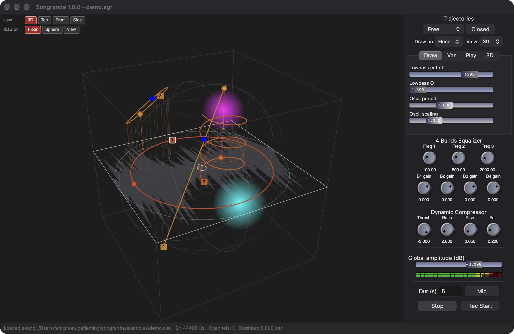

<p align="center"></p>

# songrande

**SoundGrain in a room: draw where the sound moves.**

[SoundGrain](https://github.com/belangeo/soundgrain), by Olivier Bélanger, is a granular synthesizer you play by drawing trajectories over a sound. Songrande is a development of it in which the sound lies on the floor of a room, the pen can leave the floor, and where a trajectory goes is also where its sound is heard: round you, above you, near and far. Every trajectory is a stream of grains and a source in space; all of them are encoded to Ambisonics and heard on headphones, on loudspeakers, or sent on to a decoder.



**[The manual (PDF)](docs/manual/Songrande%20Manual.pdf)** · [Request log](REQUESTS.md)

Songrande keeps SoundGrain's look and everything SoundGrain does: free-hand, circle, oscillation and line trajectories (and a new spiral), the lowpass filter on the pen, timer speed and point step, width and variation, the granulator controls and the Y axis, the FX balls, the grain envelope, MIDI, the equaliser and compressor, microphone recording, recording to disk, undo. SoundGrain itself, unchanged, is in this repository too and comes with every download as a second application.

## Credit and licence

Songrande is a **derivative work of SoundGrain 6.1.0, © 2009-2018 Olivier Bélanger**, and is released, like SoundGrain, under the **GNU General Public License version 3** ([LICENSE](LICENSE)). The folder `Resources/` and `SoundGrain.py` are SoundGrain exactly as its author published it (this repository keeps SoundGrain's git history); the folder `songrande/` began as a copy of `Resources/` and carries his copyright notices alongside the new work. The audio engine of both is his [pyo](https://github.com/belangeo/pyo) (LGPL).

## Install

Each download holds **Songrande** and **SoundGrain**, the manual, an example project and the licence.

| System | Download | Then |
| --- | --- | --- |
| macOS (Apple silicon) | `songrande-macOS-arm64.zip` | drag the two applications to `/Applications`; they are not notarised, so the first time right-click, *Open*, or run `xattr -dr com.apple.quarantine /Applications/Songrande.app /Applications/SoundGrain.app` |
| Windows (64-bit) | `songrande-Windows-x64.zip` | unzip the `Songrande` folder anywhere, start `Songrande.exe` or `SoundGrain.exe` |
| Linux (x86-64) | `songrande-Linux-x86_64.tar.gz` | unpack, run `./Songrande` or `./SoundGrain` (built on Ubuntu 22.04; needs GTK 3 and ALSA or JACK) |

The archives are built by the [build workflow](.github/workflows/build.yml) on every push (its *Artifacts*) and attached to the [releases](https://github.com/femifleming/songrande/releases).

**From the source**, with Python 3.11 or later:

```sh
pip install pyo wxPython numpy markdown   # on Linux take wxPython from your distribution or extras.wxpython.org
python Songrande.py                       # or: python SoundGrain.py
```

or `pip install .` in this folder, which gives the commands `songrande` and `soundgrain`.

## A first sound

1. **File → Open Soundfile...**, or open `examples/demo.sgr`. The waveform appears on the floor.
2. Put on headphones (Songrande starts with the *Binaural* output).
3. Draw a line on the floor and press **Start**: the sound is where the ball is.

## Drawing in three dimensions

A mouse moves over a flat screen, so the pen always draws on a surface, and one key lets it leave that surface.

- **Draw on** the **Floor** (a level plane at the pen's height), the **Sphere** (the loudspeaker sphere, so a sound keeps its distance) or the **View** plane (the plane facing you). Key `G` steps through them.
- Hold **Cmd** (macOS) or **Ctrl** (Windows, Linux) while drawing or dragging, or turn the wheel, to pull the pen **straight up or down** (in and out on the sphere). Let go and it draws on at its new height.
- **Right-drag** or **Alt-drag** empty space to walk round the room; the wheel comes closer. The **Top**, **Front** and **Side** views (keys `T`, `F`, `S`; `P` for 3D) place things exactly: the Top view is SoundGrain's own surface.
- Drag a trajectory's numbered square to move it, any other point of it to pull the line (with Cmd/Ctrl: up), the blue square to resize a circle, oscillation or spiral.
- Keys on the selected trajectory: `D` copy, `M` mirrored twin, `H` `V` `U` flips, `R` turn, `X` `Y` tilt, `[` `]` lower and raise, `-` `=` size, `Z` wrap onto the sphere, `B` flatten.

Thin lines drop from every trajectory to the floor, where its shadow lies, so its height can be read from any side. The numbers at the bottom right give the pen's place: seconds into the sound, Y, height, azimuth, elevation and distance.

The floor is SoundGrain's surface: left to right is the place in the sound, back to front is SoundGrain's Y axis. The Space Controls can change that (the sound laid round you by azimuth, or played along each path; Y from height, distance or elevation).

## What the space adds

- **Distance**: level by 1 / distance, air absorption, and a propagation delay that gives moving sounds their **Doppler** shift; a sound passing close to the head spreads round it.
- **Grain scatter**: single grains land round the trajectory, a cloud in place of a point (SoundGrain's grain panning, in space).
- **Source spread**, a **room reverb** that comes from all round and is wetter for far sounds, **scene turn** by an angle or steadily.
- **Flock**: the balls leave their lines and fly together as boids, each on a leash to its own trajectory.
- **FX balls are spheres in the room**: a stream goes through the effect while it is inside the ball, and the effect's sound comes out from where the ball is.
- **Playback direction** per trajectory: forward, backward, back and forth. A wide trajectory is a tube the ball corkscrews round.
- **Mirrored twin**, flips, turns, tilts, wrap onto the sphere.

## Output, and routing to a decoder

Chosen in **File → Open Settings**:

| Output | Channels | |
| --- | --- | --- |
| Binaural | 2 | for headphones (magnitude-least-squares decoder from the KEMAR head). The default |
| Stereo | 2 | two loudspeakers |
| Ambisonics | 4 to 64 | the scene itself, for your own decoder |
| Loudspeakers | one each | Quad, 5.0, 5.1, Hexagon, 7.1, Octagon, Cube, 5.1.4, 7.1.4, Dome 8+4+1, Icosahedron, Sphere 16, Sphere 24, or a layout file from the IEM AllRADecoder or SPARTA (AllRAD decoding) |

The Ambisonic output is **AmbiX: ACN channel order, SN3D normalisation**, the format of the IEM Plug-in Suite and SPARTA.

| Order | Channels |
| --- | --- |
| 1st | 4 |
| 2nd | 9 |
| 3rd (default) | 16 |
| 4th | 25 |
| 5th | 36 |
| 6th | 49 |
| 7th | 64 |

To play into a decoder in REAPER: choose an output device with enough channels in Settings (an interface, or a virtual device such as BlackHole 16ch or 64ch), set **Output** to *Ambisonics* and the **Order**; in REAPER make a track with as many channels, fed from that device, and put a decoder of the same order on it with SN3D normalisation, such as the IEM **AllRADecoder** or **BinauralDecoder**.

**Record the Ambisonic bus** (Settings) makes *Rec Start* write the Ambisonic scene while you listen on headphones or loudspeakers. A saved project can also be rendered offline, faster than real time:

```sh
Songrande --render project.sgr out.wav --dur 60 --output Ambisonics --order 5
```

Songrande opens SoundGrain's `.sg` projects: the surface becomes the floor.

## How it is made, and why

- **It is SoundGrain's own program**: Python, wxPython and pyo. Extending the original, rather than rebuilding it in another framework, is what keeps every SoundGrain feature and its exact look, and one code base runs on the three systems. `songrande/` is a copy of SoundGrain's package with the drawing surface and the audio graph replaced; `Resources/` stays as published.
- **The room is drawn by SoundGrain's own drawing code** (wxPython's GraphicsContext, lines projected with NumPy), not OpenGL. A room of lines is a few thousand segments, which this draws easily; it looks like SoundGrain because it is the same pens and brushes; and it needs no OpenGL driver, so it runs on build machines and in the self-test without a graphics card.
- **Spatialisation follows the IEM Plug-in Suite and SPARTA conventions** (AmbiX, x to the front, y to the left, z up; orders 1 to 7), as in the author's other spatial work (Balloon Palace's `Ambi.h`, Leitner, openfield), whose distance and Doppler model, grain scatter, scene turn and mirrored lines are carried over. The spherical harmonics, the max-rE weights, the AllRAD loudspeaker decoder and the magnitude-least-squares binaural decoder are written here in NumPy (`songrande/ambi.py`); no code of IEM or SPARTA is included. The head-related filters are made at start-up from the MIT KEMAR set that ships inside pyo.
- **The audio stays inside pyo's graph** (no Python in the audio callback beyond SoundGrain's own clock): each granulator gives out a cloud of four signals, each goes through a delay (Doppler) and a filter (air) and is weighted onto the Ambisonic channels by gains that glide from one clock tick to the next. Equaliser and compressor run on the bus, the compressor keyed by the omni channel so the image cannot bend.

| File | |
| --- | --- |
| `songrande/ambi.py` | spherical harmonics, decoders, binaural filters (NumPy, no audio, no GUI) |
| `songrande/space.py` | coordinates, camera, pointer rays, distance cues |
| `songrande/Trajectory.py`, `scene.py` | trajectories in three dimensions, drawing, editing, the clock (no GUI) |
| `songrande/audio.py` | the sound engine |
| `songrande/Surface3D.py` | the room |
| `songrande/render.py`, `selftest.py` | offline rendering; the application testing itself |

## Tests

```sh
python -m unittest discover -s tests -p "test_songrande*.py"   # Songrande
python -m unittest discover -s tests -p "test_[!s]*.py"        # SoundGrain's own
python Songrande.py --selftest out --offline                  # the application: draw, render, check, save, reload
```

The Songrande tests cover the Ambisonic conventions against the AmbiX closed forms, every decoder, the binaural filters against the measured ears, the geometry and the camera, trajectories (clock, directions, width, editing, shapes, transformations), the offline engine (a known direction gives the expected channel gains at 1st, 3rd and 7th order; the sound follows a trajectory; no clicks or NaN along moving trajectories; Doppler; every output), projects with three-dimensional trajectories, SoundGrain projects, and the application itself driven through its mouse handlers.

The [workflow](.github/workflows/build.yml) runs them on macOS, Windows and Linux, builds both applications with PyInstaller (`packaging/apps.spec`), runs the packaged programs' self-checks (`packaging/check_packaged.py`) and keeps the three archives.

## Notes

- The Windows and Linux builds are tested by the workflow (tests, the packaged self-test, the offline renderer), not by hand on those systems.
- Binaural decoding reads the first 16 channels (3rd order) of the scene.
- Work, measured as processor time of offline renders on an Apple M-series machine that was busy with other builds (so the true figures are lower): one stream on headphones about 16 % of one core, sixteen streams at 3rd order about 35 %, sixteen at 7th order about 65 %. Grain scatter makes a stream four times the work: sixteen scattered streams at 7th order are more than one core can do in real time (offline rendering always works).
- The Harmonizer FX ball is rebuilt from two swept delay lines: pyo 1.1.0's own `Harmonizer` object gave only NaN in the Linux x86-64 build used for testing (under emulation; SoundGrain's Harmonizer ball, which uses it, may be affected there), and one NaN in the Ambisonic bus would silence everything.
- Built with Claude Code (Anthropic) under the direction of [femifleming](https://github.com/femifleming).
